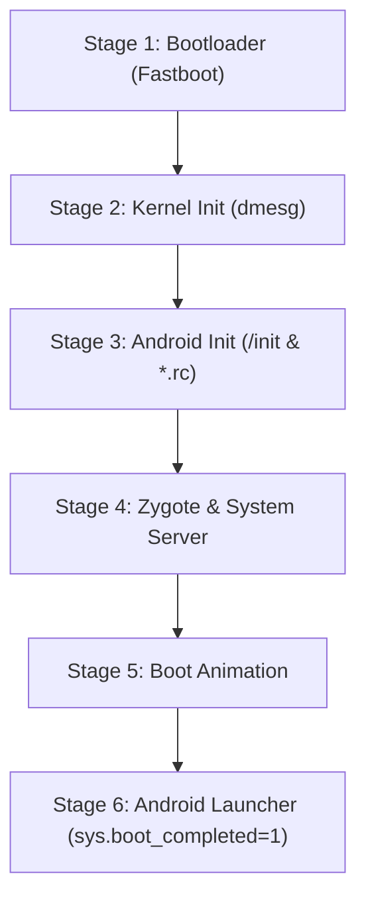

# Custom ROM Verification & Functionality Testing Guide

This guide covers how to verify whether the custom ROM is functional at every stage—from static source checks to build image inspection, emulator testing, and live device boot analysis.

---

## 1. Static Project Integrity Check (Run Anytime)

Before building, verify that all makefiles, XML configs, SELinux contexts, and scripts are present and valid:

### On Windows:
```powershell
py -3 scripts/verify_project_syntax.py
```

### On Linux / WSL2:
```bash
python3 scripts/verify_project_syntax.py
```

If any file has an XML syntax error, missing inclusion, or invalid path, the script will flag the exact file and line number.

---

## 2. Post-Build Image Inspection (Before Flashing)

Never flash an image directly without inspecting its headers and file systems.

### A. Verify `boot.img` Header Version & Offsets
Modern Android devices require **Header Version 4** with GKI:
```bash
unpack_bootimg --boot_img out/target/product/pacmanpro/boot.img
```
*Expected Output:*
- `boot magic: ANDROID!`
- `header version: 4`
- `os version: 17.0.0`

### B. Verify `system.img` Filesystem Integrity (EROFS)
Check that the system image compiled without filesystem corruption:
```bash
fsck.erofs out/target/product/pacmanpro/system.img
```
*(Should return `OK` without read errors or broken inodes).*

### C. Verify Dynamic Partitions (Super Partition)
Ensure all logical partitions (`system`, `system_ext`, `product`, `vendor`, `odm`) fit within `super.img`:
```bash
lpunpack out/target/product/pacmanpro/super.img unpacked_super/
ls -lh unpacked_super/
```

---

## 3. Testing in AOSP Emulator / QEMU (No Device Risk)

You can test the GSI `system.img` inside the official AOSP emulator before touching any physical hardware:
```bash
# Start emulator using custom system.img
emulator -system out/target/product/generic_arm64/system.img -writable-system -verbose
```
If the emulator reaches the Android setup wizard, your custom framework, UI styling, and system apps are fully functional.

---

## 4. Live Device Testing: Monitoring the 6 Boot Stages

When booting a custom ROM on physical hardware, execution progresses through 6 distinct stages. Connect your device via USB to track progress in real time.



### How to Check Each Stage:

#### Stage 1 & 2: Kernel Boot & dmesg
If the phone vibrates but displays a black screen, check kernel boot output:
```bash
adb shell dmesg
```
Look for:
- `Linux version 5.15... (android-build@google)`
- `MediaTek MT6886 platform initialized`

#### Stage 3: Android Init & Hardware Nodes
Check if `/init` started hardware services:
```bash
adb shell ps -A | grep -E "hal|vendor|init"
```

#### Stage 4 & 5: Live Android System Logs (logcat)
The most important command during initial boot:
```bash
adb logcat -b all -v color
```
*Key indicators to watch:*
- `AndroidRuntime: Calling main entry com.android.server.SystemServer` (System server started successfully).
- `SurfaceFlinger: SurfaceFlinger is initialized` (Display and Mali GPU drivers active).

#### Stage 6: Verify Boot Completed
Execute:
```bash
adb shell getprop sys.boot_completed
```
- **If output is `1`:** The ROM has **booted successfully** and the Android framework is fully functional!
- **If output is empty or `0`:** The system is still initializing or stuck in a bootloop.

---

## 5. Hardware Subsystem Verification Checklist

Once the phone boots into Android, test each hardware component using the following commands:

### 1. Check ROM Branding & Android Version
```bash
adb shell getprop ro.aether.version
adb shell getprop ro.build.version.release
```
*Expected:* `AetherOS-17.0-ALPHA-...` and `17`.

### 2. Check Display 120Hz Refresh Rate
```bash
adb shell dumpsys display | grep -i "fps"
```
*Expected:* Peak refresh rate reporting `120.00 Hz`.

### 3. Check Nothing Glyph Interface LED Control
Test whether the sysfs interface triggers the Glyph LEDs:
```bash
# Turn on all Glyph LED strips at 50% brightness
adb shell "echo 128 > /sys/class/leds/aw210xx_led/all_leds_effect"

# Turn off Glyph LEDs
adb shell "echo 0 > /sys/class/leds/aw210xx_led/all_leds_effect"
```

### 4. Check Optical Under-Display Fingerprint Sensor
```bash
adb shell dumpsys fingerprint
```
Verify that the Goodix biometric HAL is registered and reporting ready state.

### 5. Check Audio Output (SmartPA / Speakers)
```bash
adb shell dumpsys audio | grep -i "STREAM_MUSIC"
```

### 6. Check Wi-Fi & Cellular Data (RIL)
```bash
adb shell dumpsys wifi | grep -i "mWifiInfo"
adb shell dumpsys telephony.registry | grep -i "mDataConnectionState"
```

### 7. Check SELinux Enforcing Status & Denials
Ensure the system is operating securely without illegal permission denials:
```bash
adb shell getenforce
```
*Expected:* `Enforcing`.

To inspect any blocked actions:
```bash
adb shell "dmesg | grep 'avc: denied'"
```
*(Zero denials means perfect SELinux compatibility).*
